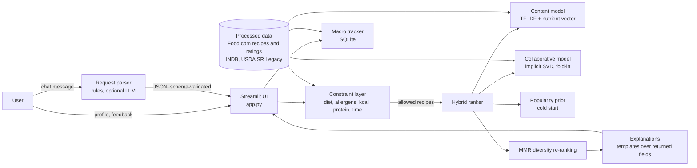

# NutriMate

**An AI-based personalized food recommendation assistant using hybrid filtering and dietary constraints**

Ninad N Hebbar, Nishant Satish Pai
Department of Information Science and Engineering, M S Ramaiah Institute of Technology, Bengaluru

NutriMate suggests recipes that match a user's taste, diet and nutrition targets, and tracks daily
calories and macros. It is built so that each part does the job it can actually be trusted with:

- the **ML recommender** (content-based + collaborative filtering) ranks recipes,
- the **structured datasets** supply every nutrition number, with its basis (per serving or per 100 g) and source,
- the **constraint layer** enforces diet, allergen and nutrient rules before anything is shown,
- the **chat layer** only turns a message into a validated JSON request and explains the results the backend returned.

The chat parser works offline with rules. An LLM can be plugged in with an API key, but it is optional
and it never produces nutrition values.

## What the demo does

| Tab | What you can do |
|---|---|
| Profile | Diet (any, eggetarian, vegetarian, vegan), allergens, disliked ingredients, cuisines, liked ingredients, optional daily targets and per-meal limits. Saved in SQLite. |
| Recommendations | Ranked recipe cards with the score breakdown (content, CF or popularity, goal fit, final), "why this" reasons built from the recipe fields, source and nutrition-status badges, like / dislike / log buttons. Likes update the profile straight away. |
| Chat assistant | Type a request such as "high-protein vegetarian dinner under 600 calories, avoid peanuts, something Indian". You see the parsed JSON, the results and a templated explanation. Ambiguous input gets a follow-up question instead of a guess. |
| Macro tracker | Log a recipe (servings) or an INDB / USDA food (grams or servings). Consumed vs target vs remaining, edit and delete, chart. Unknown values are shown as missing, not counted as zero. |
| Evaluation | The offline results tables and charts from `scripts/evaluate.py`. |
| Data and sources | Dataset provenance, licences, subset statistics and the raw data inspection report. |

## Architecture



The model and data code lives in the `nutrimate/` package, separate from the UI, so the same functions
are used by the app, the evaluation script and the tests.

## Setup on Windows (PowerShell)

Python 3.10, 3.11 or 3.12. Every package installs from a prebuilt wheel, no C compiler needed.

```powershell
cd nutrimate
py -3.11 -m venv .venv
.\.venv\Scripts\Activate.ps1
# if activation is blocked: Set-ExecutionPolicy -Scope CurrentUser RemoteSigned
python -m pip install --upgrade pip
pip install -r requirements.txt

# run the app (processed data and trained models are already included)
streamlit run app.py
```

The app opens at http://localhost:8501.

Optional checks:

```powershell
python -m pytest -q              # 30 tests: constraints, unknown nutrients, parser schema, tracker maths
python scripts\smoke_test.py     # runs the main functions once without the UI
```

On macOS or Linux use `python3 -m venv .venv` and `source .venv/bin/activate`; the rest is the same.

## Rebuilding the data, models and results

Only needed if you want to reproduce everything from the raw files.

```powershell
python scripts\download_data.py   # about 760 MB into data\raw\ (no login needed)
python scripts\inspect_data.py    # Milestone 0 report -> results\data_inspection.md
python scripts\preprocess.py      # -> data\processed\  (about 30 s)
python scripts\evaluate.py        # -> results\*.csv, results\*.png  (about 2 min)
python scripts\train.py           # -> models\  (fits on all ratings for the app)
```

`evaluate.py` fits its own models on the training split only. `train.py` then fits the app's models on
all ratings, using the number of SVD factors chosen on the validation split.

## Optional LLM parser

By default the chat uses the rule-based parser. To try an LLM instead, set a key before starting the app:

```powershell
$env:NUTRIMATE_LLM_API_KEY = "your key"           # or OPENAI_API_KEY
$env:NUTRIMATE_LLM_MODEL = "gpt-4o-mini"           # optional
$env:NUTRIMATE_LLM_BASE_URL = "https://api.openai.com/v1"   # optional, any OpenAI-compatible endpoint
streamlit run app.py
```

The LLM output must pass the same JSON schema as the rule-based parser. If the call fails or the JSON
is invalid, the app falls back to the rules and says so. Keep keys out of the code and out of Git.

## Project structure

```
nutrimate/
  app.py                    Streamlit app (UI only, calls the package)
  nutrimate/
    config.py               paths and default weights
    data.py                 loading processed data, None for unknown nutrients
    constraints.py          keyword lists, diet / allergen / nutrient filter, per-recipe check
    content.py              TF-IDF + nutrient vector content model
    collab.py               implicit SVD (ranking) and biased MF (rating prediction)
    hybrid.py               hybrid scoring, cold start, goal fit, MMR
    parser.py               chat request parser, JSON schema, optional LLM
    explain.py              template explanations from returned fields
    tracker.py              SQLite meal log, profile and feedback
    metrics.py              temporal split, precision / recall / NDCG, diversity, RMSE
  scripts/
    download_data.py  inspect_data.py  preprocess.py  evaluate.py  train.py  smoke_test.py
  tests/                    pytest tests
  data/processed/           processed subset used by the app (about 6 MB)
  data/raw/                 raw downloads (not included)
  models/                   saved models used by the app
  results/                  evaluation tables, charts, data inspection report
  README.md  METHODOLOGY.md  DATA_DICTIONARY.md  DEMO_SCRIPT.md
```

## Data

| Source | Used for | Notes |
|---|---|---|
| Food.com Recipes and Reviews (Kaggle dataset by A. Irkaal, CC0), copy from the `jiava/foodrs-data` Hugging Face dataset | recipes, ingredients, tags, per-serving nutrition, user ratings | nutrition is in kcal and grams per serving, which is why we used this version |
| Food.com RAW_recipes / RAW_interactions (Majumder et al., 2019), course mirror | inspected only | its nutrition column is %DV for six of seven fields, so not used for macros |
| Indian Nutrient Databank, INDB 2024.11 (Anuvaad) | tracker lookup for 1,014 Indian dishes | per 100 g and per serving |
| USDA FoodData Central SR Legacy (2018) | tracker lookup for 7,793 basic foods | per 100 g, public domain |

`download_data.py` does not fetch the Majumder files. They are optional and only feed section 2 of the
inspection report; to reproduce it, put `RAW_recipes.csv` and `RAW_interactions.csv` in `data/raw/`
(course mirror linked from https://practicaldsc.org/final-project/datasets/recipes-and-ratings/).

The processed subset has 7,903 recipes (6,721 with ratings plus 1,182 extra Indian recipes without
ratings in the subset) and 225,842 ratings from 3,666 users. Details are in METHODOLOGY.md and
DATA_DICTIONARY.md. Please cite the INDB paper (Vijayakumar et al., Current Developments in Nutrition, 2024)
and Majumder et al. (EMNLP 2019) if you use those sources in a report.

## Results in one table

Temporal test split, 3,665 users, top-10 lists, a rating of 4 or 5 counts as relevant.

| Model | Precision@10 | Recall@10 | NDCG@10 | Coverage |
|---|---|---|---|---|
| Popularity | 0.0220 | 0.0255 | 0.0293 | 0.007 |
| Content only | 0.0055 | 0.0048 | 0.0065 | 0.371 |
| CF only (implicit SVD, 16 factors) | 0.0236 | 0.0271 | 0.0305 | 0.040 |
| Hybrid, w_cf = 0.75 | 0.0232 | 0.0264 | 0.0305 | 0.059 |
| Hybrid, w_cf = 0.75, with MMR | 0.0235 | 0.0270 | 0.0308 | 0.057 |

The full set (weight sweep, rating RMSE, cold start, constraint check) and what the numbers mean are in
METHODOLOGY.md, section 9. With the hard filter on, 0 of 15,000 checked recommendations broke a
machine-checkable rule.

## Important limits

- Allergen checks are keyword matching on the recipe text. A recipe that does not mention an allergen is
  "not found in the listed text", not "safe". Anyone with a real allergy has to check the recipe.
- Food.com nutrition is user-contributed recipe data computed by the site; values can be off. We removed
  176 values that failed plausibility checks, but the rest are not lab-verified.
- This is not medical or dietetic advice. Targets are whatever the user types in.
